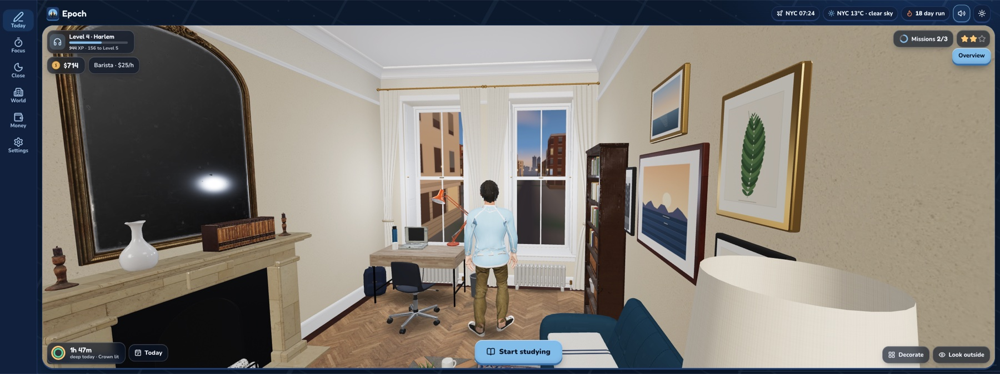
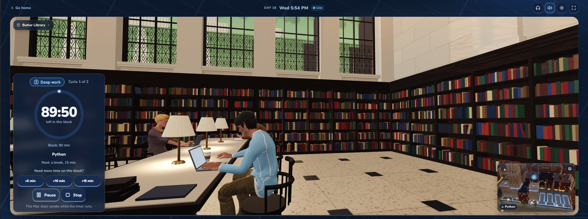
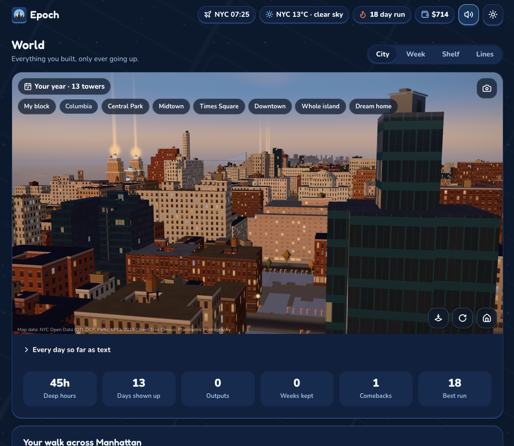
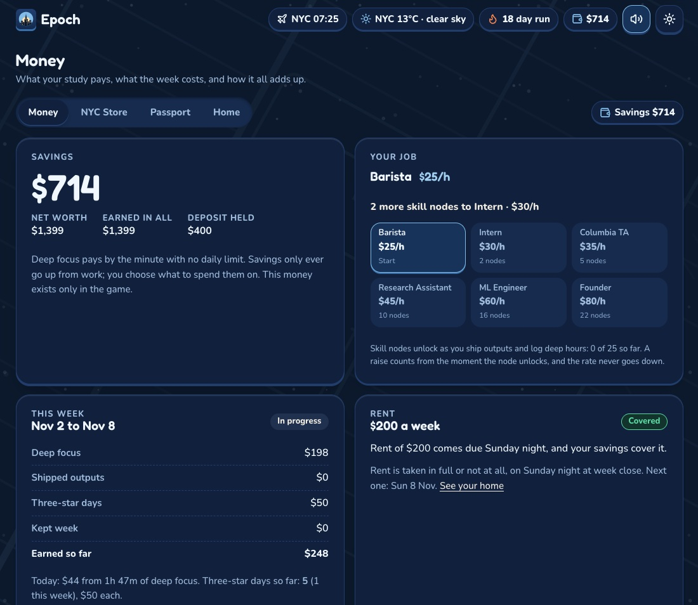

# Epoch

**A local study tracker that plays like a city-builder.** Log the hours you study, ship something each week, and watch a 3D model of real Manhattan grow a tower for every day you showed up.


<sub><b>Today.</b> Your studio: level and XP, savings and job, today's missions and stars, and deep minutes so far. Epoch also has a light theme.</sub>

Epoch runs on your own computer and opens in the browser. There is no account, no cloud and no cost. Everything is stored in one SQLite file.

## What it does

- **Log fast.** Type `45m numpy ex 1-12` and press Enter, or tap a one-tap repeat. Epoch works out the category and the minutes.
- **Keep a promise.** Set a daily floor and a weekly contract (hours plus shipped outputs). Epoch tracks kept weeks, skips, repairs and comebacks, and never shames you for a bad day.
- **Focus.** A full-screen Pomodoro timer (50/10, 25/5, 90/15) that can run on a second screen, such as a tablet next to your laptop.
- **Build a city.** Each day becomes a tower on a real lot in Morningside Heights, in a 3D Manhattan built from NYC Open Data. Fly around it, with live weather and seasonal decorations.
- **Live the game.** Study earns XP (levels walk you down the island) and in-game money for rent, furniture, NYC experiences and a bigger home. The money has no real-world value.
- **Optional extras.** Telegram nudges and phone logging, a free OpenRouter model for messy log lines, and ActivityWatch to label the gaps in your day. Skip any of them and nothing breaks.


<sub><b>Focus run.</b> A timed block at your seat in Butler Library: Deep work, a 90-minute dial, +5/+10/+15 to extend, and a mini map of the tower growing while you work.</sub>

<table>
<tr>
<td width="50%"><br><sub><b>World › City.</b> Thirteen days, thirteen towers on real Morningside lots. Fly to Columbia, Central Park, Midtown, Times Square or downtown.</sub></td>
<td width="50%"><br><sub><b>Money.</b> Deep focus pays by the minute, the job ladder raises your rate, and rent is due every Sunday.</sub></td>
</tr>
</table>

## Quick start

You need Python 3.10 or newer. Epoch is built and used on macOS; the server and the web app are plain Python, but the launcher scripts and desktop notifications are Mac-only.

```bash
git clone https://github.com/hariv24/epoch.git
cd epoch
python3 -m venv .venv
source .venv/bin/activate
pip install -r requirements.txt
cp .env.example .env      # optional, see Configuration
python -m epoch
```

Open http://127.0.0.1:8765. Stop it with Ctrl+C. Your data is created in `data/` on first run.

## What to expect

The first run is an empty studio. Your first logged hour lights a window, your first full day puts a tower on your block, and from there the loop is:

1. **Today.** Log what you did. Press **Start studying** to begin a focus run.
2. **Close.** In the evening, label any unlogged stretches and seal the day.
3. **World.** On Sunday, see whether the week was kept and keep, raise or lower the contract.
4. **Money.** Spend what you earned on rent, the store and your home.

The tabs are Today, Focus, Close, World (City, Week, Shelf, Lines), Money and Settings. Every page also works with JavaScript turned off.

More detail is in the [user guide](docs/GUIDE.md): the daily routine, the XP table, every setting, backups, the one-click Mac launcher and start-at-login.

## Configuration

Everything in `.env` is optional. See [.env.example](.env.example).

| Variable | What it does |
|---|---|
| `TELEGRAM_BOT_TOKEN`, `TELEGRAM_USER_ID` | Nudges and logging from your phone. Only that one user id can use the bot. |
| `OPENROUTER_API_KEY`, `OPENROUTER_MODELS` | A free model for messy log lines and the weekly summary. Only `:free` models are called, capped at 100 calls a day. |
| `EPOCH_PORT` | Use another port (default 8765). |
| `EPOCH_DATA_DIR` | Where the database lives (default `./data`). |
| `EPOCH_BACKUP_DIR` | A folder (for example in iCloud Drive) for nightly backups. |
| `EPOCH_LAN=1` | Listen on your home network for [tablet mode](docs/GUIDE.md#use-it-on-your-tablet). |
| `ACTIVITYWATCH_URL` | Where to find ActivityWatch (default `http://localhost:5600`). |

## Privacy

Everything stays on your machine. The only outside request the app makes is the New York weather from Open-Meteo (no key, nothing about you), which you can turn off in Settings. If you set an LLM key, only text you typed is sent to it, never window titles or app names. Details are in the [guide](docs/GUIDE.md#privacy).

## Project layout

```
epoch/            the app: rules, game, economy, parser, scheduler, Telegram bot
  web/            FastAPI + Jinja2 templates, and the front end
    static/app/   style.css, app.js and the three.js city, room and focus scenes
tests/            pytest suite (python -m pytest -q)
scripts/          launcher, launchd and data-build scripts
docs/             specs and design notes (start with GUIDE.md and ARCHITECTURE.md)
```

Run the tests with `python -m pytest -q`. They never touch the network.

## Credits and license

Code is [MIT](LICENSE). The city is built from [NYC Open Data](https://opendata.cityofnewyork.us/). Fonts, 3D models, textures and libraries keep their own licences; see the `LICENSES.md` files next to them under `epoch/web/static/`. The Mixamo characters and animations are not included in this repo, so the people in the city and rooms are missing until you add your own.
